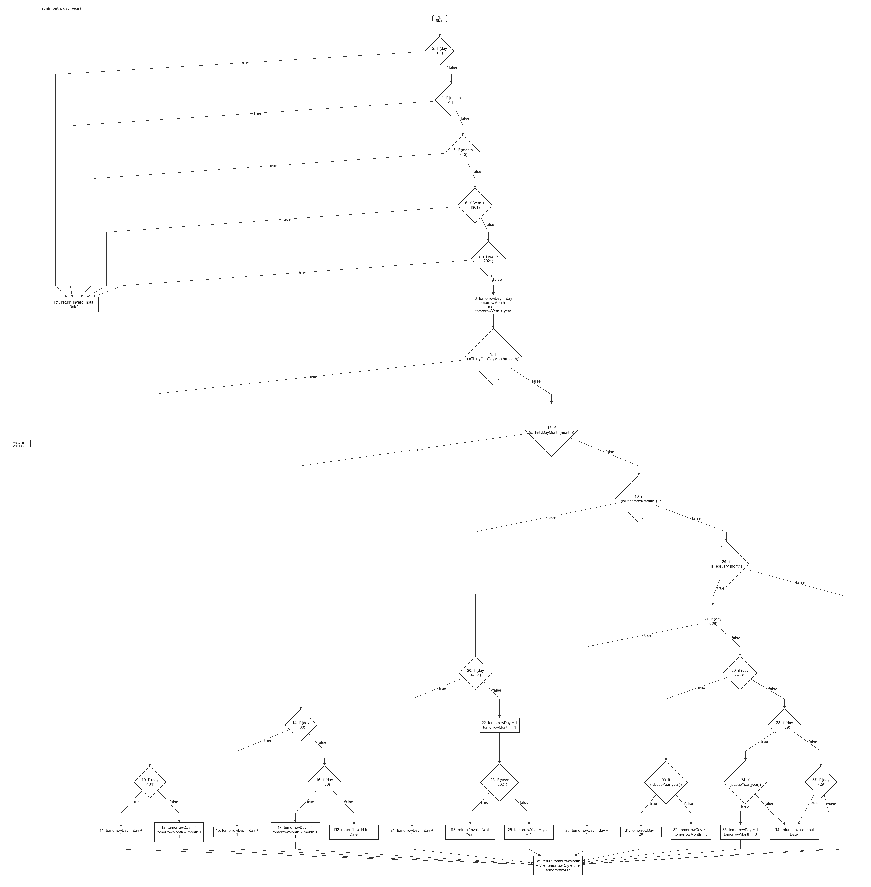

# ETSN20 Lab 1: White-Box Testing

## 2 Preparation (on paper, no AI tools)

### Assignment 1
Read chapters 4 and 5 in [1] and the slides from lecture 2.


### Assignment 2
Look at the program below. How many feasible paths are there for this program? Define a set of test cases that gives you 100% coverage of all the feasible paths. Define test cases in terms of [input, output, execution conditions if any].

```
input(score);
if score < 45 then
   print ('fail');
else
   print ('pass');
if score > 80 then
   print (' with distinction');
end
```

> **Svar:**
> 3 Testcases:
> 
>     Input1 40 -> fail
>     Input3 65 -> pass
>     Input3 90 -> pass with distinction


### Assignment 3
In this lab session you will test the `NextDate` program using white-box techniques. Get an understanding of how the program works. The code is available at the course website.


### Assignment 4
a) Draw a flow graph of the `run` method in the `NextDate` class, and
b) calculate the McCabe's Cyclomatic Complexity measure of that method.

> **Svar a) – Flödesgraf:**
>
> 
>
> [Redigerbar draw.io-version](NextDate_CFG.drawio) · [Mermaid-källkod](../NextDate_CFG.mmd)

> **Svar b):**
>
> &nbsp;
>
> &nbsp;

### Assignment 5
Analyze the code and calculate the minimum number of test cases if the goal is:
a) 100% Statement coverage
b) 100% Branch coverage

> **Svar:**
>
> &nbsp;
>
> &nbsp;
>
> &nbsp;

### Assignment 6
Based on the flow graph, prepare a minimum set of test cases for statement and branch coverage. You may re-use test cases for the different coverage types, but have **separate sets of test cases for each coverage type** so that you can compare the coverage types, e.g. no. of test cases, bugs found etc.

> **Svar:**
>
> &nbsp;
>
> &nbsp;
>
> &nbsp;

### Assignment 7
If you haven't used JUnit before, read the instructions available at <http://junit.org/junit4/> (for example, start by looking under the tag "Getting started"). Ensure that you know how to use JUnit before you arrive at the exercise where you are supposed to implement test cases in the tool.

> **Svar:**
>
> &nbsp;
>
> &nbsp;
>
> &nbsp;

## 3 Exercise (on computer)

Thoroughly test the `NextDate` program using white-box testing and the test cases you have prepared on paper. Remember to specify test case ID, what is tested, description, input, expected output and other useful information while executing your test cases. You may also want to note information on pass/fail and other observations, in preparation for the lab report. An example defect report can be found in Appendix 1.

Implement test cases using JUnit and the coverage tool EclEmma. If not already done, install the Code Coverage plug-in EclEmma (www.eclemma.org) available via Eclipse Market Place, see Help menu.

### Assignment 8
Implement and execute test cases (defined in assignment 6) for achieving full
a) statement coverage, and
b) branch coverage.

Record your test results carefully for your test report, and compare the coverage given by the tool to what you initially calculated and expected. Look at both the calculated coverages (*Properties -> Coverage* on `NextDate.java`) and consider the green/yellow/red markings for the `NextDate` program.

If you didn't cover all statements and branches, implement more test cases to do so. If not possible, consider why.

> **Svar:**
>
> &nbsp;
>
> &nbsp;
>
> &nbsp;

### Assignment 9
Now turn to your favourite generative AI tool and prompt it to generate test cases for the `NextDate` program.

> **Svar:**
>
> &nbsp;
>
> &nbsp;
>
> &nbsp;

### Assignment 10
Reflect on the outcome of the lab exercises. In particular, consider the following questions:

- How many and which test cases did you select for each coverage criteria (statement, branch)?
- What was the final coverage you achieved? (Compare with measures as given by the coverage tool?) Did you achieve full coverage: how, why not?
- How many more test cases would be needed for predicate coverage? What would the added value be?
- What do the coverage types presented by the tool represent/correspond to?
- How many lines of test code did you produce, compared to the lines of code under test?
- What were the main differences between the test cases you generated yourself and the ones generated by GenAI?

> **Svar:**
>
> &nbsp;
>
> &nbsp;
>
> &nbsp;

## 4 Examination

Typical exam questions on this material are [1, chapter 4, p. 111, Exercises 1, 2, 3, 7 and chapter 5, p. 133–134, Exercises 1, 2].

## References

[1] Naik K. and Tripathy P., *Software Testing and Quality Assurance*, John Wiley & Sons, 2008.

## Appendix 1

### Test case description

| Test ID | Method Under Test | Test Purpose | Input | Expected Result | Remarks |
|---------|-------------------|--------------|-------|-----------------|---------|
| TC5     | `isInsurable()`   | In range     | 44    | True            | None    |

### Defect report

| Defect ID | Method Under Test | Description of Defect | Expected Result | Actual Result | Remarks |
|-----------|-------------------|-----------------------|-----------------|---------------|---------|
| DR3       | `isInsurable()`   | When individual is female over 85 the output is True, where actual output should be False. | False | True | Severe Defect |
